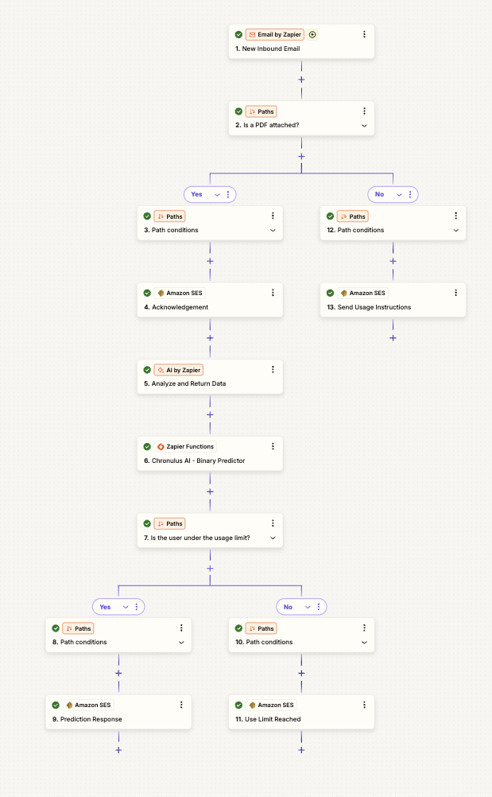

## Screen My Pitch

Screen My Pitch is a fun but useful demonstration of how easy it is to integrate Chronulus AI Agents into your Zapier workflows. 

To screen your pitch:

<ul>
<li>
Draft or forward an email to <a href='mailto:screen-my-pitch.9e6sfs@zapiermail.com'>screen-my-pitch.9e6sfs@zapiermail.com</a>
</li>
<li>
The email should contain a pitch attached as single PDF. No other file types are accepted and the PDF should be under 35MB.
</li>
<li>
If no PDF is attached, you will get this email (again).
</li>
<li>
Use Limit: You can screen up to 5 pitches in this demo per email address.
</li>
</ul>

### The Zap Overview

The Chronulus Binary Predictor is implemented in **Step 6** of the diagram below as a Zapier Python Function.

You can find the source for the function at [src/main.py](src/main.py).

### About Chronulus AI Agents

<a href="https://www.chronulus.com">Chronulus AI</a> is an agentic forecasting and prediction platform that makes it easy for builders to predict anything.

If you enjoy the demo, consider subscribing to one of our plans at <a href="https://www.chronulus.com">chronulus.com</a>. Chronulus is currently bootstrap funded and depends on the support of users like you.

